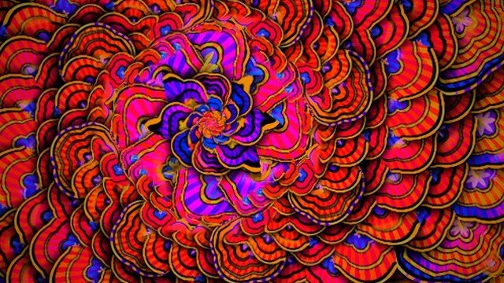
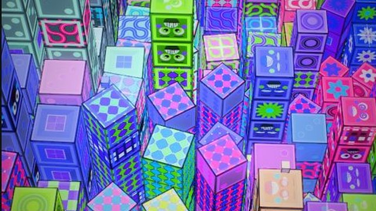
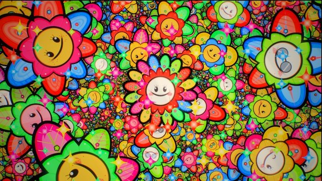
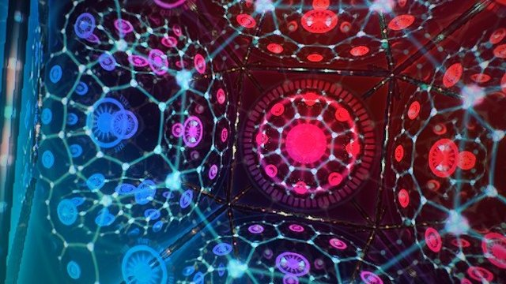
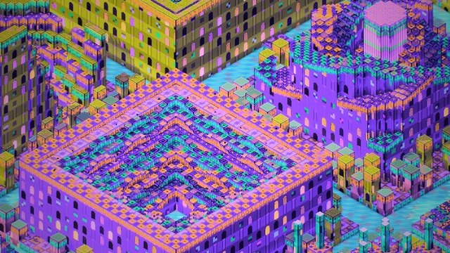
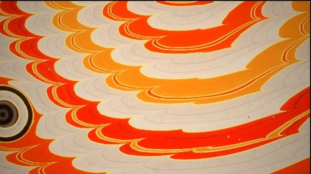

# Psychonautica Visualizer

A music visualizer you can get lost in. Press play, put on your music, and it travels by itself through
thirty hand-made scenes that dance to what it hears: endless flowers, stained-glass cathedrals, cities of
boxes, swarms, marbled paper, machine elves. It runs in a browser from one HTML file. No install, no
account, nothing sent anywhere.

It is a gift. Use it at home, at a party, on stage. And if you want a scene that does not exist yet, this
repository is set up so that you, or a coding agent you point at it, can make one.

**Run it now:** <https://diddlysquatt.github.io/psychonautica-visualizer/>
(psychonautica.net links here too.) **Gallery of scenes:**
<https://diddlysquatt.github.io/psychonautica-visualizer/gallery/>

| | | |
|---|---|---|
|  |  |  |
|  |  |  |

## Run it

- **Online:** open the link above.
- **Offline:** download `dist/psychonautica-visualizer.html` and double-click it. That one file is the whole
  thing.
- Play the built-in song, drop in your own music files, or let it listen to your microphone or a browser tab.
- The Auto Show does everything: which scene, how long, the camera, the kaleidoscope. You never have to
  touch a control. If you want to, press **H** (or tap the top or bottom edge on a phone) for the controls.
- It needs a browser with WebGL2 (any current Chrome, Edge, Firefox or Safari). It runs on phones; a
  computer with a graphics card shows far more detail.
- A note on comfort: scenes flash and move with the music. The Flashes control turns that down, and the
  visualizer starts calmer if your system asks for reduced motion.

## Make it yours

Open Controls > Scenes > Edit to switch scenes on and off, put them in your own order, give each its own
length, save that as a playlist, or copy a link that opens the visualizer on your set. Add a scene someone
else made with "+ Scene". Details: [docs/PLAYLISTS.md](docs/PLAYLISTS.md),
[docs/SCENE-PACKS.md](docs/SCENE-PACKS.md).

## Make a scene

A scene is a small folder: one GLSL shader and a few lines of JavaScript that turn the music into numbers.
You do not have to read the engine.

```
python tools/new-scene.py aurora "AURORA"                # start from the template
node tools/build.mjs . dist/aurora.html --scenes aurora  # a small build with only your scene: open it
npm install && node tools/check-scene.mjs aurora         # checks, and a contact sheet to look at
python tools/pack.py aurora                              # one file you can share
```

- Start here: [docs/MAKE-A-SCENE.md](docs/MAKE-A-SCENE.md)
- Everything a scene receives and must do: [docs/SCENE-CONTRACT.md](docs/SCENE-CONTRACT.md)
- What makes a scene belong: [docs/ART-DIRECTION.md](docs/ART-DIRECTION.md)
- What goes wrong: [docs/PITFALLS.md](docs/PITFALLS.md) · Testing: [docs/TESTING.md](docs/TESTING.md)
- Working with a coding agent? Point it at [AGENTS.md](AGENTS.md). It is written for that.

Every built-in scene is in [`scenes/`](scenes/) with its source and a short README, so there are thirty
worked examples to learn from.

## Share a scene

- **Just share it:** `tools/pack.py` makes one `.scene.js` file. Post it in
  [Discussions](https://github.com/diddlysquatt/psychonautica-visualizer/discussions); anyone can add it
  with "+ Scene". (A scene pack is code: only add packs from people you trust.)
- **Into the collection:** open a pull request that adds your scene's folder. It is reviewed, built into
  the visualizer and shown in the gallery. See [CONTRIBUTING.md](CONTRIBUTING.md).

Questions, ideas, things you made with it: the
[Discussions](https://github.com/diddlysquatt/psychonautica-visualizer/discussions) board is the forum.
Bugs: [Issues](https://github.com/diddlysquatt/psychonautica-visualizer/issues).

## How the repository is laid out

```
dist/psychonautica-visualizer.html   the visualizer, built
scenes/<key>/                        one folder per scene (shader, JavaScript, scene.json, README, thumb)
src/                                 the engine, in small parts
tools/                               build, new-scene, check-scene, pack, gallery
docs/                                the guides
gallery/                             the scene gallery page (generated)
```

The single file is built from `src/` and `scenes/` by `tools/build.py` or `tools/build.mjs` (same result;
use Python 3.8+ or Node 18+). Nothing else is needed to build. [docs/ARCHITECTURE.md](docs/ARCHITECTURE.md)
describes the engine in one page.

## Licence

Copyright Stoned Ape / Psychonautica and contributors.

The code (the engine and the scenes) is free software under the GNU Affero General Public License, version
3 or later: see [LICENSE](LICENSE) and [NOTICE.md](NOTICE.md). In plain words: you may use it, change it
and share it; if you pass on a changed version, or run one as a public web service, you share your source
under the same licence.

**What you make with it is yours.** Videos, recordings, live visuals and screenshots made with the
visualizer belong to whoever made them and are not covered by the AGPL.

## Credits

Made by Stoned Ape / Psychonautica, with a lot of help from AI coding agents. Scenes in `scenes/` name
their authors in `scene.json`.
